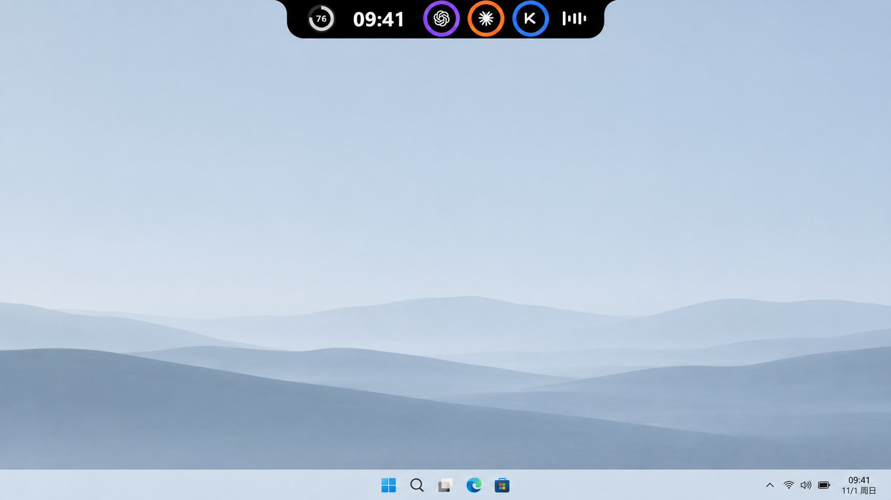
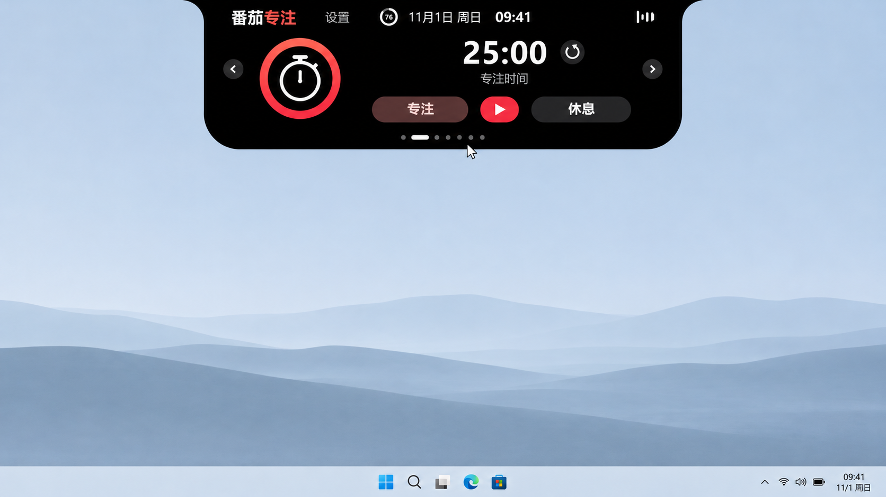
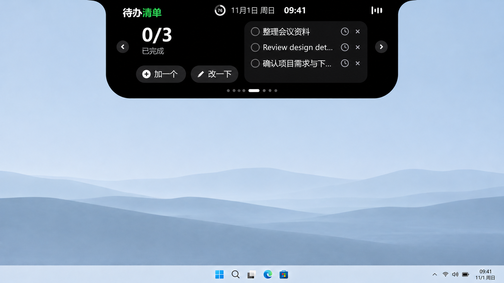
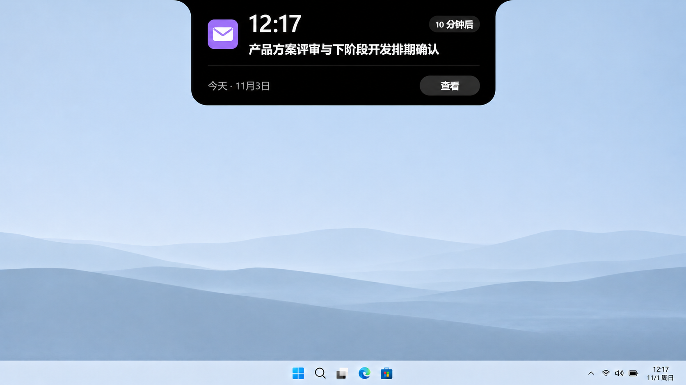

<div align="center">


# 岛仔（内网版）· Daozai Intranet

**让重要的信息，轻轻出现在屏幕顶部。**

Windows 桌面伙伴 · 音乐与歌词 · 日程提醒 · 内网 AI 对话

> 本仓库是 [岛仔 Daozai](https://github.com/Renly1994/xiaotang-daozai) 的**内网定制版**：
> 移除了 AI 额度、邮件 IMAP、在线更新等外网依赖，新增了可自定义接口的 AI 对话页，
> 灵动岛展开状态下支持整体等比缩放。

[](https://github.com/Renly1994/xiaotang-daozai/releases/latest)
[](#安装与更新)
[](LICENSE)
[](https://github.com/Renly1994/xiaotang-daozai/actions/workflows/ci.yml)

[下载 Windows 版](https://github.com/mosekeji/xiaotang-daozai/releases) · [上游项目](https://github.com/Renly1994/xiaotang-daozai) · [使用指南](docs/USAGE.md) · [更新记录](CHANGELOG.md)

</div>



## 一个小岛，装下桌面上的小事

岛仔贴在屏幕顶部，收起时是一条小刘海。鼠标靠近时展开，离开时收起；需要处理的信息出现时再提醒你。它由 Rust 和 egui 构建，不依赖 Electron。

| 功能 | 可以做什么 |
| --- | --- |
| 等比缩放（新增） | 灵动岛展开状态下整体等比缩放（0.75×–2.0×）；在展开的岛右上角点 ＋/－ 调整，或到「设置 → AI 对话 → 缩放」里拖滑块 |
| 桌面伙伴 | 会眨眼、打盹、喝水，也会拿起麦克风跟着音乐唱；可切换极简模式 |
| 音乐与歌词 | 读取 Windows 媒体会话，控制播放、切歌、进度；支持岛上单行歌词 |
| 专注与饮水 | 专注／休息计时、饮水目标、提醒时段、快捷记录与撤销 |
| 文件置物架 | 拖入临时收集，打开或定位原文件，拖出到其他应用；移除记录不删除原文件 |
| 待办 | 添加、编辑、完成任务；用日期和时间选择器设置可选提醒 |
| AI 对话（新增） | OpenAI 兼容接口；在设置里自定义 API 地址、API Key 和模型名；支持把文件直接拖到岛上随消息发送 |
| 日程 | 月历和当日安排；支持本地日程与 CalDAV 工作日历（可指向内网服务），全天、跨天、重复日程及单次修改／取消 |
| 系统提示 | 电源、电量、网络、音量、大写锁定、输入语言和蓝牙设备状态 |

### 专注工作，也记得休息和喝水

开始一段专注时间，在专注与休息之间切换；饮水面板记录当天进度，可以设置目标和提醒时段。



### 待办随手记，文件临时放

把待办加到屏幕顶部，完成后勾选；需要提醒的事项可以单独设置日期和时间。置物架则用来临时收集文件，支持打开、定位原文件和拖出到其他应用。



### 日程与 AI 对话，都在屏幕顶部



- 日程支持本地新增与 CalDAV 工作日历同步（飞书／钉钉／企业微信，可指向内网服务）。
- 同一场日程使用 UID 与开始时间去重，会议开始前自动提醒。
- AI 对话页可自定义内网大模型服务；请求由岛直接发往你填写的地址。
- 对话支持文件拖拽：文本文件内容直接随消息发送，二进制文件附文件名说明。

以上为基于演示界面制作的 AI 产品展示图，展示收起、展开与提醒状态，界面细节以实际版本为准。[查看原始界面截图](docs/images)。

## 安装与更新

1. 前往 [Releases](https://github.com/Renly1994/xiaotang-daozai/releases/latest)，下载安装版 `Daozai-Setup-v0.6.49-x64.exe`。
2. 双击安装器，可修改安装位置、选择是否创建桌面快捷方式和开机自启，再点击「一键安装」。桌面快捷方式默认勾选，首次安装默认不开机自启；无需解压。
3. 安装完成后打开「岛仔」，也可从桌面快捷方式启动。在托盘菜单打开设置，选择需要的功能。

需要免安装使用时，下载 `Daozai-v0.6.49-windows-x64.zip` 并完整解压，运行其中的 `daozai.exe`。程序仍默认使用当前用户的应用数据目录。

内网版不提供在线更新。安装方式与上游一致：从 Release 下载安装器或免安装 ZIP；卸载通过 Windows「已安装的应用」完成，用户数据保留。详细操作见 [使用指南](docs/USAGE.md)。

**系统要求：** Windows 10／11 x64，支持 OpenGL 的显卡驱动。Windows 11 已进行本机实测；Windows 10、不同显卡及多显示器组合的兼容性仍需更多反馈。暂不提供 macOS、Linux 或 ARM64 成品包。

**校验下载：** Release 附带 `SHA256SUMS.txt`，可用 `Get-FileHash -Algorithm SHA256` 比对。当前程序未做商业代码签名，Windows 可能提示未知发布者；请核对仓库与文件校验值后再决定运行。

## 连接哪些服务

| 类型 | 当前入口 | 说明 |
| --- | --- | --- |
| AI 对话 | 自定义 OpenAI 兼容接口 | 在设置里填写接口地址、API Key 和模型名；适合内网部署的大模型服务（如 vLLM、Ollama 的 OpenAI 兼容层） |
| 工作日历 | 飞书、钉钉、企业微信 | CalDAV；需要平台提供的独立日历账号／密码，可指向内网服务 |

**内网版移除的联网功能**：邮件 IMAP 收信与验证码、AI 额度（Codex／Claude／Kimi 等）、在线更新、在线歌词（默认关闭）。音乐控制、专注、饮水、待办、置物架、系统提示均为本机功能。

## 数据留在什么地方

- 设置、待办、饮水记录、置物路径和连接元数据保存在 `%APPDATA%\Daozai`。
- AI 对话的接口地址、Key 和模型名保存在 `%APPDATA%\Daozai\settings.txt`；对话内容只在内存中，不落盘。
- 日历密码保存在 Windows 凭据管理器。
- 除 AI 对话与日历同步外，内网版不访问任何外部服务。

完整说明见 [隐私与安全](docs/PRIVACY.md)。

## 从源码构建

需要 Rust stable、MSVC C++ 构建工具和 Windows SDK。开发时建议使用较新的 stable Rust。

```powershell
rustup default stable-x86_64-pc-windows-msvc
cargo build --locked --release --bin daozai
.\target\release\daozai.exe
```

运行测试及打包：

```powershell
cargo test --locked --all-targets --features record -- --test-threads=1
powershell -NoProfile -ExecutionPolicy Bypass -File .\scripts\package.ps1
```

测试按单线程运行，以隔离使用进程环境变量的数据目录测试。低内存设备可设置 `$env:CARGO_BUILD_JOBS = "1"`。打包需要 NSIS 3，可通过 `-NsisCompiler` 指定 `makensis.exe`。发布脚本会检查程序版本和运行库依赖，生成单文件 EXE 安装器、精简免安装 ZIP 和 SHA-256 校验文件。

项目结构、界面预览与贡献方式见 [开发指南](CONTRIBUTING.md)。

## 开源与致谢

岛仔原创代码采用 [MIT License](LICENSE)。Rust 依赖、vendored 代码、第三方图标及品牌标识沿用各自的许可或权利声明；MIT 不授予这些服务的商标使用权，也不代表官方合作或认证。详见 [第三方声明](THIRD_PARTY_NOTICES.txt) 和 [依赖说明](docs/DEPENDENCIES.md)。

感谢 egui／eframe、Rust 社区，以及提供参考与素材的开源项目。
